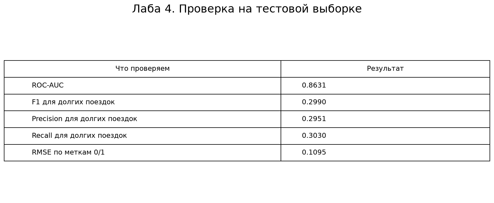
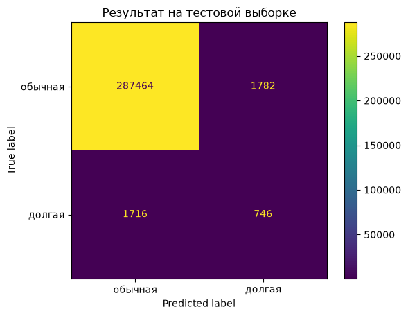

# Лабораторная работа №4

## Запуск

Куликов Максим, группа 202М.

Обучаем случайный лес для поиска поездок дольше часа. MLflow автоматически
сохраняет параметры модели, метрики обучения и саму модель. Метрики тестовой
выборки и текстовый отчёт тоже записываются в этот же запуск.

## 1. Установка

Нужны Python 3.12, Git и Git LFS. Команды выполняются в терминале.

```bash
git lfs install
git clone https://github.com/Merhaba228/applied-ai-lab4.git
cd applied-ai-lab4
git lfs pull
python -m venv .venv
```

Windows PowerShell:

```powershell
.\.venv\Scripts\python.exe -m pip install -r requirements.txt
$env:Path = "$PWD\.venv\Scripts;" + $env:Path
.\.venv\Scripts\python.exe -m dvc repro
.\.venv\Scripts\python.exe src/train.py
```

Linux / macOS:

```bash
.venv/bin/python -m pip install -r requirements.txt
export PATH="$PWD/.venv/bin:$PATH"
.venv/bin/python -m dvc repro
.venv/bin/python src/train.py
```

## 2. Результаты в MLflow

После обучения запустить из папки проекта:

```powershell
.\.venv\Scripts\python.exe -m mlflow ui --backend-store-uri sqlite:///mlflow.db --host 127.0.0.1 --port 5000 --workers 1
```

На Linux / macOS использовать `.venv/bin/python` вместо Windows-пути.
Открыть http://127.0.0.1:5000, выбрать `NYC Taxi Lab 4`, затем запуск
`random_forest_baseline`. В Parameters будут параметры, в Metrics метрики,
в Models обученная модель, в Artifacts файлы `metrics.json` и `report.txt`.
Повторный запуск `src/train.py` создаст новый экспериментальный запуск.

Локальные база MLflow и модель появляются после обучения. Они не загружены
в Git. Сохранённые результаты проверенного запуска лежат в папке `results`.

## 3. Отчёт

### Подготовка данных

Использовали NYC Taxi и очистку из третьей лабы. Было 1 458 644 строки,
после удаления 107 строк осталось 1 458 537. Если поездка длилась больше
3600 секунд, ставим класс 1, иначе 0.

В обучение пошло 1 166 829 строк, в тест 291 708.
В тесте 2462 поездки дольше часа. Тестовые строки модель при обучении не видела.

### Обучение

Взяли случайный лес как первую модель, с которой дальше можно сравнивать улучшения.
Использовали 80 деревьев, глубину 12 и минимум 20 поездок в листе.
Вес долгих поездок поставили 5, обычных 1, чтобы модель чаще обращала
внимание на редкий класс. В этой лабе перебор параметров не делали.

### Что получилось

| Метрика на тесте | Значение |
| --- | ---: |
| ROC-AUC | 0.8631 |
| F1 | 0.2990 |
| Precision | 0.2951 |
| Recall | 0.3030 |
| RMSE по меткам | 0.1095 |



Из всех настоящих долгих поездок модель нашла около 30%.
Из поездок, которые она назвала долгими, около 30% действительно оказались такими.
ROC-AUC выше, потому что оценивает порядок вероятностей при разных порогах,
а precision и recall здесь считаются при одном пороге 0.5.
Долгих поездок мало, и мы не используем данные о высадке.
Поэтому высокая общая accuracy сама по себе мало говорит о поиске этого класса.



На картинке видно, что модель правильно нашла 746 долгих поездок,
пропустила 1716 и ошибочно назвала долгими 1782 обычные поездки.
Точный текстовый отчёт лежит в [results/report.txt](results/report.txt).

### Что сохранил MLflow

Запуск завершился со статусом `FINISHED`. В нём записались 37 параметров
и 12 метрик, включая автоматические метрики обучения и наши метрики теста.
Обученная модель получила статус `READY`.
Её загрузили обратно из MLflow и повторно посчитали F1 на тесте: результат совпал.
Сведения об этом запуске сохранены в [results/mlflow_run.json](results/mlflow_run.json).

Картинки выше построены по результатам проверки, это не снимки интерфейса MLflow.
Сам интерфейс доступен локально после запуска команды из пункта 2.

### Вывод

1. Обучили базовую модель и получили первые метрики на отдельном тесте.
2. MLflow сохранил параметры, оценки и модель, поэтому результат не нужно собирать вручную.
3. Качество поиска долгих поездок пока невысокое. Этот запуск можно использовать для сравнения со следующими моделями.

## 4. Что оцениваем

ROC-AUC считается по вероятностям аномалии. F1, precision и recall относятся
к классу поездок дольше часа, порог вероятности 0.5. RMSE посчитан между
истинными и предсказанными метками 0/1, чтобы выполнить список метрик задания.
Это не ошибка длительности в секундах; для нашей задачи важнее ROC-AUC и F1.

Используются только перевозчик, число пассажиров, координаты посадки, час
и день недели начала поездки. Разбиение 80/20, `random_state=42`, с сохранением
доли классов. Заполнение пропусков в модели обучается только на train.
Очищенный набор создаётся кодом третьей лабы; поездки свыше 24 часов исключены
по её правилам. Поэтому результаты относятся именно к этому набору.

## 5. Файлы

- `src/prepare_data.py`: очистка из третьей лабы.
- `src/train.py`: обучение, оценка и логирование в MLflow.
- `dvc.yaml`, `dvc.lock`: этап подготовки данных.
- `results/metrics.json`, `results/report.txt`: результаты запуска.
- `requirements.txt`: проверенные версии библиотек.

## Датасет

По смыслу DVC тяжёлые данные должны храниться отдельно от Git. Но для учебной работы архив добавлен через Git LFS, чтобы проект можно было клонировать и запустить без отдельной настройки хранилища.

Архив не хранится как обычный текстовый файл Git. DVC-файл `data/raw/nyc-taxi-trip-duration.zip.dvc` и `dvc.lock` оставлены для демонстрации версионирования данных.

После настройки отдельного DVC-хранилища архив можно убрать из Git LFS и получать командой `dvc pull`.

Автологирование используется по [документации MLflow](https://mlflow.org/docs/latest/ml/tracking/autolog/).
